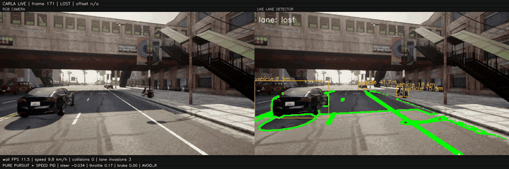
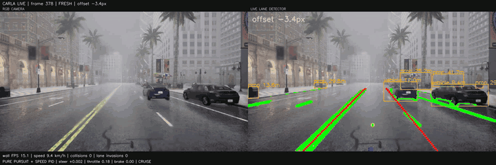
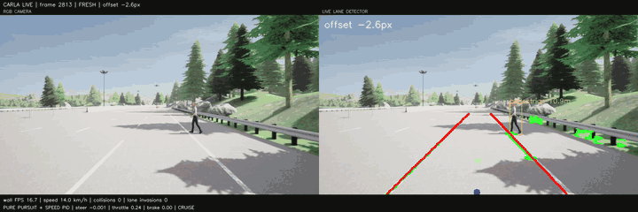
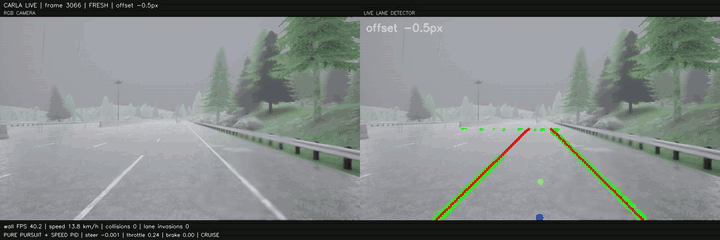
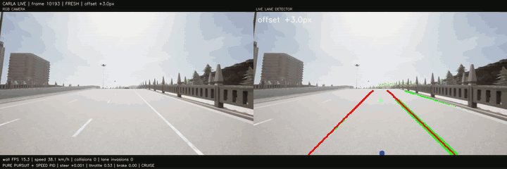
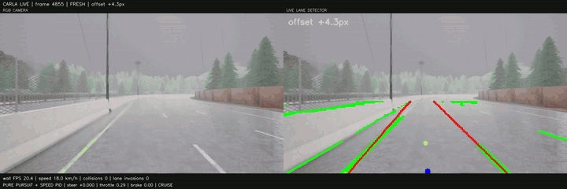
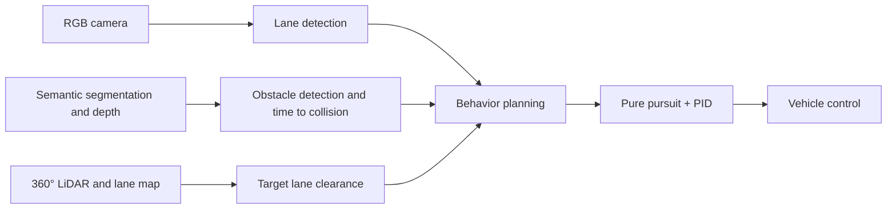

# AutoPilot

A proof of concept for autonomous driving in CARLA. AutoPilot detects and follows lane markings, detects obstacles, and changes lanes to pass when the target lane is clear.

## Demos by map and weather

The GIFs were captured in CARLA at `Epic` graphics quality and cover both PoC weather modes. The RGB camera feed is on the left and the detection overlay is on the right.

| Map | Clear (`clear`) | Heavy rain (`rain`) |
|---|---|---|
| **Town10HD_Opt** | <br>Passing a parked car | <br>Slowing down for a cut-in |
| **Town04_Opt** | <br>Yielding to a pedestrian | <br>Lane keeping with RGB detection |
| **Town05** | <br>Slowing down for a vehicle ahead | <br>Lane keeping in heavy rain |

## Install CARLA

Download CARLA 0.9.16 for the PoC and set up the Python environment. [CARLA Quick Start](https://carla.readthedocs.io/en/latest/start_quickstart/) · [CARLA 0.9.16 release](https://github.com/carla-simulator/carla/releases/tag/0.9.16)

```bash
mkdir -p ~/carla-0.9.16
cd ~/carla-0.9.16
curl -fL -o CARLA_0.9.16.tar.gz https://downloads.carlasim.com/Linux/CARLA_0.9.16.tar.gz
tar -xzf CARLA_0.9.16.tar.gz

conda create -n autopilot python=3.11 -y
conda activate autopilot
pip install carla

cd PythonAPI/carla/dist
pip install carla-0.9.15-cp37m-manylinux_2_27_x86_64.whl

cd PythonAPI/examples
pip install -r requirements.txt
```

Start the CARLA server on Town10HD_Opt and leave this terminal open. To run without a window, add `-RenderOffScreen`. Camera sensors still produce images in this mode. [CARLA rendering options](https://carla.readthedocs.io/en/0.9.16/adv_rendering_options/#off-screen-mode)

```bash
cd ~/carla-0.9.16
./CarlaUE4.sh -carla-rpc-port=3000
```

<a name="tái-lập-từ-clone-sạch"></a>

## Run AutoPilot

```bash
git clone https://github.com/khanhhdt/AutoPilot.git
cd AutoPilot
conda activate autopilot
pip install -r requirements.txt
```

Check the connection. The expected output is version `0.9.16` and map `Carla/Maps/Town10HD_Opt`.

```bash
python -c 'import carla; c = carla.Client("localhost", 3000); c.set_timeout(5); print(c.get_server_version(), c.get_world().get_map().name)'
```

Run the obstacle avoidance scenario to exercise lane detection, lane keeping, and obstacle detection. The command records a video with Full HD RGB and overlay panels.

```bash
python -m scripts.run_suite --host localhost --port 3000 \
  --case avoid --video-hd 1920
```

## How it works



<a name="phase-56--kiểm-chứng-và-demo"></a>

## License

[MIT](LICENSE)
