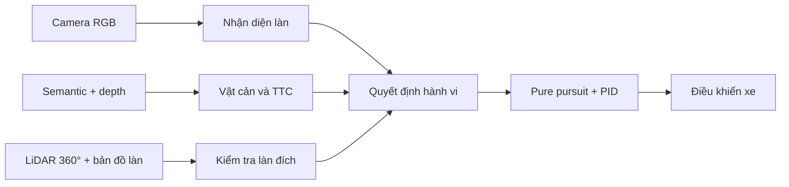

# AutoPilot

PoC lái xe tự hành trong CARLA với nhận diện làn đường, giữ làn, phát hiện vật cản và chuyển làn để vượt khi làn đích trống.


## Cài đặt CARLA

Các lệnh dưới đây tải bản CARLA 0.9.16 dùng cho PoC. [CARLA Quick Start](https://carla.readthedocs.io/en/latest/start_quickstart/) · [Bản phát hành 0.9.16](https://github.com/carla-simulator/carla/releases/tag/0.9.16)

```bash
sudo apt update
sudo apt install -y curl git ffmpeg libgl1 libglib2.0-0

mkdir -p ~/simulators/carla-0.9.16
cd ~/simulators/carla-0.9.16
curl -fL -o CARLA_0.9.16.tar.gz https://downloads.carlasim.com/Linux/CARLA_0.9.16.tar.gz
tar -xzf CARLA_0.9.16.tar.gz
```

Khởi động server trên Town10HD_Opt và giữ terminal này mở. Cờ `-RenderOffScreen` vẫn cung cấp hình ảnh cho camera khi chạy ngoài màn hình. [Chế độ render của CARLA](https://carla.readthedocs.io/en/0.9.16/adv_rendering_options/#off-screen-mode)

```bash
./CarlaUE4.sh /Game/Carla/Maps/Town10HD_Opt -carla-rpc-port=3000 \
  -RenderOffScreen -quality-level=Low -nosound
```

<a name="tái-lập-từ-clone-sạch"></a>

## Chạy AutoPilot

```bash
git clone https://github.com/khanhhdt/AutoPilot.git
cd AutoPilot
python3.11 -m venv .venv
source .venv/bin/activate
pip install -r requirements.txt
```

Kiểm tra kết nối. Kết quả mong đợi là phiên bản `0.9.16` và map `Carla/Maps/Town10HD_Opt`.

```bash
python -c 'import carla; c = carla.Client("localhost", 3000); c.set_timeout(5); print(c.get_server_version(), c.get_world().get_map().name)'
```

Chạy hệ thống nhận diện làn, giữ làn, phát hiện vật cản và tránh. Lưu video RGB + overlay Full HD.

```bash
python -m scripts.run_suite --host localhost --port 3000 \
  --case avoid --video-hd 1920
```

## Cách hệ thống hoạt động



<a name="phase-56--kiểm-chứng-và-demo"></a>

## Nghiệm thu PoC

Để CARLA ở chế độ async với world rảnh. Cần `ffmpeg` hỗ trợ `libx264` và `drawtext`, cùng `ffprobe` để kiểm tra video.

```bash
python -m scripts.verify_poc \
  --ffmpeg /usr/bin/ffmpeg --ffprobe /usr/bin/ffprobe
```

Ca `clear-road` đặt mục tiêu **50 km/h** trên đoạn thẳng trống. Xe phải giữ tốc độ đo được trong dải **50 ± 1,5 km/h** liên tục ít nhất **1 giây**, với 0 va chạm và 0 chạm vạch. Các ca vật cản và đường cong dùng mục tiêu 10 km/h.

Chạy riêng tiêu chí đường trống bằng `python -m scripts.run_suite --case clear-road`. Video nghiệm thu có hai ô Full HD và phát ở **30 FPS** từ mô phỏng **20 Hz**.

| Kiểm chứng bản `poc-v1.0` | Kết quả |
|---|---|
| Nhận diện làn thuần RGB | M1-v2 đạt 4/4 phiên, 96,3% khung đủ ground truth đạt ngưỡng |
| Tránh vật cản | 20/20 ca, 0 va chạm, 0 lần bắt đầu chuyển làn khi làn đích bị chặn |
| Trời quang và mưa | 4/4 lượt, gồm giữ làn qua cua và phản ứng với xe cắt vào |

[Kiến trúc](docs/ARCHITECTURE.md)

## Giấy phép

[MIT](LICENSE)
