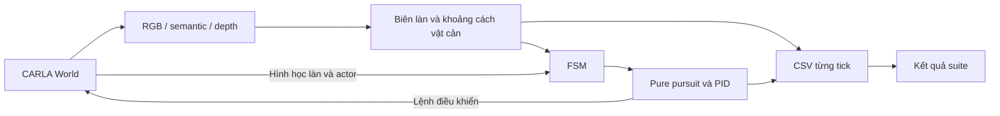

# Báo cáo kiểm chứng Phase 5–6

## Kiến trúc

Luồng xử lý trong [sơ đồ Mermaid](diagram.mmd) bắt đầu ở các camera RGB,
semantic và depth đồng bộ theo ID tick. Client phát hiện làn và ước tính
khoảng cách vật cản, chọn trạng thái FSM rồi áp lệnh qua pure pursuit và PID.
Mô phỏng cung cấp hình học làn và kích thước actor để kiểm tra vùng mù khi
chuyển làn. Log từng tick được tổng hợp thành bảng theo kịch bản và chỉ số
toàn bộ suite.

## Điều kiện chạy

- CARLA 0.9.16 tại `localhost:3000`, Town10HD_Opt, trời quang, NVIDIA RTX 4090.
- Server render ngoài màn hình, chất lượng Low. Camera RGB 512×288, semantic
  và depth 192×108. Bước mô phỏng 0,05 s, mục tiêu 10 km/h. Cả sáu ca ghi video.
- Tệp `frames.csv` chứa thời gian mô phỏng, tốc độ, steer, sai số ngang
  `lane_error_m`, TTC, số va chạm và số lần chạm vạch tích lũy. Quãng đường
  tính từ các vị trí ego liên tiếp. TTC lấy khoảng cách hiện tại chia cho tốc
  độ khép khoảng cách qua cửa sổ 5 mẫu cùng làn và loại vật cản, nếu đủ mẫu
  và tốc độ khép lớn hơn 0,2 m/s.
- FPS thực bằng số frame hợp lệ chia cho thời gian đo. Các chỉ số trên km
  dùng tổng sự kiện chia cho tổng quãng đường, tính cả dữ liệu của ca thất
  bại nếu ca đó đã sinh báo cáo. Tỷ lệ đạt dùng tổng số ca đã lên lịch làm mẫu số.

## Phase 5

| Kịch bản | Kết quả | Quãng đường (m) | Va chạm | Chạm vạch | TTC min (s) | FPS thực |
|---|---|---:|---:|---:|---:|---:|
| Đường trống | PASS | 19,71 | 0 | 0 | N/A | 19,97 |
| Rào chắn | PASS | 10,87 | 0 | 0 | 3,62 | 19,97 |
| Xe cắt vào | PASS | 17,06 | 0 | 0 | 1,50 | 19,91 |
| Người đi bộ | PASS | 23,43 | 0 | 0 | 3,89 | 19,97 |
| Vượt phải | PASS | 26,64 | 0 | 4 | 2,80 | 19,97 |
| Vượt trái | PASS | 26,76 | 0 | 5 | 2,69 | 19,97 |
| **Tổng** | **6/6 (100%)** | **124,46** | **0** | **9** | **1,50** | **19,96** |

Toàn suite đạt **0 va chạm/km** và ghi nhận **72,31 sự kiện chạm vạch/km**.
Chín sự kiện đều thuộc hai ca chuyển làn chủ động, trong hành lang hai làn của
kịch bản. Không có timeout hoặc nhảy tick. Cả 7 unit test offline đạt,
bao phủ IPM, polyfit, hướng lái và giới hạn pure pursuit, quãng đường và TTC.

Kết quả chi tiết nằm trong `output/phase5/run_20261126_111711_298107/`,
gồm `report.md`, `metrics.csv`, `metrics.json`, `summary.json` và dữ liệu từng tick.

## Phase 6

Video `demo.mp4` trong thư mục kết quả ghép các đoạn tiêu biểu của đủ sáu ca,
giữ ba ô RGB, semantic và overlay. Video H.264 có kích thước **1536 × 392 px**,
**20 FPS**, dài **41,25 giây** và đã được giải mã kiểm tra toàn bộ. Lệnh dựng
lại video có trong [README](../README.md#phase-56--kiểm-chứng-và-demo).

**M3 đạt.** Sau khi clone một snapshot Git tạm của mã trong workspace,
chạy đúng [ba lệnh trong README](../README.md#tái-lập-từ-clone-sạch) bằng Python
3.11. Clone bắt đầu với Git sạch và chưa có dữ liệu, output hay môi trường ảo.
Ca vượt phải tái lập đạt **PASS**, thu 210 frame và video, không va chạm trên
26,64 m. Suite trả server về async và dọn toàn bộ actor thử nghiệm.
`output/phase6/clean_clone.json` và `output/phase6/clean_clone.log` lưu bằng chứng.

## Hạn chế và hướng phát triển

- Bộ sáu ca bao phủ các tình huống định trước ở tốc độ thấp, trời quang
  trên một map. Mở rộng thêm map, hạt giống, điều kiện ánh sáng, mưa và
  tốc độ để đánh giá độ ổn định.
- Kiểm tra làn kề dựa một phần vào dữ liệu actor của CARLA. Thay nguồn này
  bằng cảm biến bao phủ hai bên và phía sau để đánh giá phương án dựa trên cảm biến.
- TTC hiện là ước tính dọc từ khoảng cách depth. Việc đổi vật thể cùng loại
  và nhiễu khoảng cách có thể làm thay đổi giá trị. Theo dõi định danh vật thể
  theo thời gian và thêm TTC theo quỹ đạo cắt ngang để cải thiện đánh giá.
- Bộ sáu ca có tổng quãng đường ngắn. Tách sự kiện cắt vạch khi chuyển làn có
  chủ đích và sự kiện rời làn ngoài kế hoạch trước khi so sánh tỷ lệ trên quãng
  đường dài. Số FPS trên cấu hình render Low mô tả riêng lần đo này.
